<h1>
  
  <picture>
    <source srcset="https://fonts.gstatic.com/s/e/notoemoji/latest/1f44b_1f3fd/512.webp" type="image/webp">
    
  </picture>
  <picture>
    <source srcset="https://fonts.gstatic.com/s/e/notoemoji/latest/1faf0_1f3fd/512.webp" type="image/webp">
    
  </picture>
</h1>

<!--
**O3k1/O3k1** is a ✨ _special_ ✨ repository because its `README.md` (this file) appears on your GitHub profile.

Here are some ideas to get you started:

- 🔭 I’m currently working on ...
- 🌱 I’m currently learning ...
- 👯 I’m looking to collaborate on ...
- 🤔 I’m looking for help with ...
- 💬 Ask me about ...
- 📫 How to reach me: ...
- 😄 Pronouns: ...
- ⚡ Fun fact: ...
-->

Hi, I'm **Obashola** (aka **sholly**/**O3k1**), though most people call me **Oba** 👋🏽

- 💼 I'm currently a full-time Associate Patent Examiner in Computing & Telecoms at the UK Intellectual Property Office.
- 🎓 I hold a BEng (Hons) in **Cyber Security** and I am pursuing an **MSc in Science, Technology, Engineering and Public Policy (STEaPP)** [@UCL](https://www.ucl.ac.uk/).
- 🔬 My work and research focus on **tech policy**, **emerging tech security**, and examining patents ranging from **computer networks** to **Physics (G01 classification)** [CPC classification](https://worldwide.espacenet.com/patent/cpc-browser#!/CPC=G01), with the most interesting patent I've seen so far relating to EEG that can be used in medical contexts, neuroscience research and BCI.
- 💬 Ask me about **cybersecurity, anything tech (tech products, tech policy, etc.), patents, Linux setups**, or anything else!

 

  
  
  
  

 

## 🛠️ Languages and Tools

 

  
  

  
  
  
  
  

 

## ⚡️ Stats

 

  
  
   
  

  
Visitor count:

  

  

